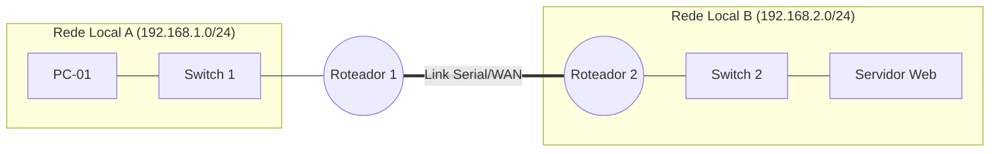

# 🧪 Laboratório: {{title}}

> [!abstract] Objetivo do Experimento
> Breve descrição da topologia, protocolo ou serviço que está sendo configurado e testado.

---

## 🗺️ Topologia da Rede



---

## 📊 Tabela de Endereçamento IP
| Dispositivo | Interface | Endereço IP | Máscara / CIDR | Gateway Padrão | Observações |
| :--- | :--- | :--- | :--- | :--- | :--- |
| **PC-01** | eth0 | 192.168.1.10 | 255.255.255.0 (/24) | 192.168.1.1 | Cliente |
| **R1** | g0/0/0 | 192.168.1.1 | 255.255.255.0 (/24) | - | Gateway LAN A |
| **R1** | s0/1/0 | 10.0.0.1 | 255.255.255.252 (/30) | - | Link Ponto a Ponto |
| **R2** | s0/1/0 | 10.0.0.2 | 255.255.255.252 (/30) | - | Link Ponto a Ponto |
| **Servidor**| eth0 | 192.168.2.10 | 255.255.255.0 (/24) | 192.168.2.1 | Servidor HTTP/DNS |

---

## 🛠️ Comandos & Scripts de Configuração

### 1. Configuração do Roteador / Switch (Cisco IOS)
```text
Router> enable
Router# configure terminal
Router(config)# hostname R1
Router(config)# interface g0/0/0
Router(config-if)# ip address 192.168.1.1 255.255.255.0
Router(config-if)# no shutdown
Router(config-if)# exit
```

### 2. Comandos no Terminal Linux / Host
```bash
# Verificar configuração de interfaces
ip addr show

# Testar rota e gateway
ip route show

# Testar conectividade básica
ping -c 4 192.168.2.10

# Rastrear caminho dos pacotes
traceroute 192.168.2.10
```

---

## 🔍 Testes de Conectividade e Validação
- [ ] Ping entre PC1 e seu Gateway local (Sucesso: 100%)
- [ ] Ping de ponta a ponta (PC1 até Servidor)
- [ ] Teste de serviço de aplicação (HTTP, DNS, SSH, etc.)

---

## 🩺 Diagnóstico e Troubleshooting
> [!question] Ocorreu algum erro durante o lab?
> - **Sintoma:** 
> - **Causa identificada:** (Ex: rota estática ausente, máscara incorreta, interface em *shutdown*)
> - **Solução aplicada:** 

---

## 📌 Conclusões e Aprendizados
- O que funcionou conforme o esperado?
- Qual foi o principal aprendizado prático em relação à teoria vista no livro?
