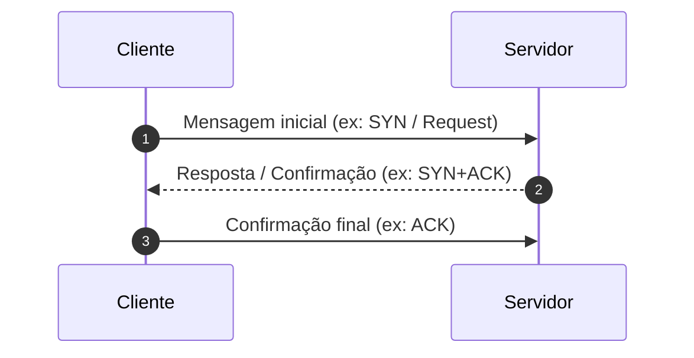

# 🌐 Protocolo {{title}}

> [!summary] O que é?
> **Definição em uma frase:** [Explique de forma direta o que o protocolo faz e qual necessidade da rede ele atende].

---

## ⚙️ Características Fundamentais
- **Camada:** `camada_tcp_ip` / `camada_osi`
- **PDU (Unidade de Dados):** `pdu`
- **Tipo de Serviço:** 
  - [ ] Orientado a conexão (Connection-oriented)
  - [ ] Não orientado a conexão (Connectionless)
  - [ ] Confiável (com confirmação e retransmissão)
  - [ ] Não confiável / Melhor esforço (Best effort)
- **Porta(s) Padrão:** `porta_padrao` (ex: 80, 443, 53, 22)
- **Transporte Base:** `protocolo_transporte`

---

## 📦 Estrutura do Cabeçalho (Header)

```text
 0                   1                   2                   3
 0 1 2 3 4 5 6 7 8 9 0 1 2 3 4 5 6 7 8 9 0 1 2 3 4 5 6 7 8 9 0 1
+-+-+-+-+-+-+-+-+-+-+-+-+-+-+-+-+-+-+-+-+-+-+-+-+-+-+-+-+-+-+-+-+
|          Campo 1              |          Campo 2              |
+-+-+-+-+-+-+-+-+-+-+-+-+-+-+-+-+-+-+-+-+-+-+-+-+-+-+-+-+-+-+-+-+
|                         Campo 3                               |
+-+-+-+-+-+-+-+-+-+-+-+-+-+-+-+-+-+-+-+-+-+-+-+-+-+-+-+-+-+-+-+-+
```

### Principais Campos & Significados:
| Campo | Tamanho (bits/bytes) | Função / Importância |
| :--- | :--- | :--- |
| **Campo A** | X bits | Explicação do funcionamento |
| **Campo B** | Y bits | Explicação do funcionamento |
| **Flags / Bits de Controle** | Z bits | Ex: SYN, ACK, FIN, RST |

---

## 🔄 Fluxo de Operação / Funcionamento



### Detalhes do Processo:
1. **Estabelecimento / Inicialização:** 
2. **Transferência de Dados:** 
3. **Encerramento / Finalização:** 

---

## 💻 Prática, Ferramentas & Wireshark
- **Filtro de Exibição Wireshark:**
  ```text
  protocol_name == ...
  ```
- **Comandos no Terminal (Linux/Windows):**
  ```bash
  # Inspecionar sockets ou conexões ativas
  ss -tulpn
  
  # Captura rápida de pacotes
  sudo tcpdump -i any -n [filtro]
  ```

---

## ⚖️ Comparativo com Protocolos Similares
| Critério | {{title}} | Protocolo Alternativo |
| :--- | :--- | :--- |
| **Confiabilidade** |  |  |
| **Overhead de Cabeçalho**|  |  |
| **Velocidade / Latência**|  |  |
| **Caso de Uso Típico** |  |  |

---

## 🎯 Pegadinhas de Prova & Dúvidas Comuns
> [!caution] Cuidado na Prova!
> - Diferença crucial que professores adoram cobrar:
> - O que acontece em caso de perda ou erro no pacote?
